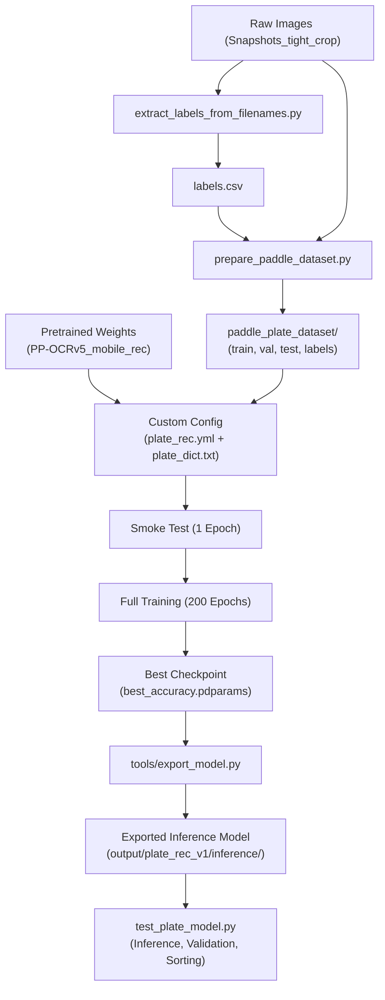

# Custom Indian License Plate Recognition (PP-OCRv5 Mobile)

A complete end-to-end pipeline for training, exporting, and deploying a lightweight, high-accuracy Indian License Plate Recognition model using **PaddleOCR (PP-OCRv5 Mobile Recognition)**.

Supported formats include standard **High Security Registration Plates (HSRP)** (e.g. `MH12AB1234`, `DL1C1234`) and **Bharat Series (BH)** plates (e.g. `23BH6041E`).

---

## Table of Contents

- [Overview & Architecture](#overview--architecture)
- [Project Structure](#project-structure)
- [End-to-End Pipeline](#end-to-end-pipeline)
- [Requirements & Environment Setup](#requirements--environment-setup)
- [Step-by-Step Guide](#step-by-step-guide)
  - [1. Extract Labels from Image Filenames](#1-extract-labels-from-image-filenames)
  - [2. Prepare the PaddleOCR Dataset](#2-prepare-the-paddleocr-dataset)
  - [3. Clone PaddleOCR](#3-clone-paddleocr)
  - [4. Character Dictionary Setup](#4-character-dictionary-setup)
  - [5. Training Configuration (`plate_rec.yml`)](#5-training-configuration-platerecyml)
  - [6. Verify Dataset Integrity](#6-verify-dataset-integrity)
  - [7. Run a Smoke Test](#7-run-a-smoke-test)
  - [8. Run Full Model Training](#8-run-full-model-training)
  - [9. Checkpoint Selection](#9-checkpoint-selection)
  - [10. Export Model for Inference](#10-export-model-for-inference)
  - [11. Testing & Inference](#11-testing--inference)
  - [12. Deployment to Another Project](#12-deployment-to-another-project)
- [Configuration Reference](#configuration-reference)
- [Troubleshooting & FAQs](#troubleshooting--faqs)

---

## Overview & Architecture

- **Base Model**: PP-OCRv5 Mobile Recognition
- **Backbone**: PPLCNetV3 (scale: 0.95)
- **Algorithm**: SVTR_LCNet
- **Head**: MultiHead (CTCHead + NRTRHead)
- **Loss**: MultiLoss (CTCLoss + NRTRLoss)
- **Vocabulary**: 36 custom characters (digits `0-9` and uppercase letters `A-Z`)
- **Input Dimension**: Dynamic multi-scale training (`[3, 32, 320]`, `[3, 48, 320]`, `[3, 64, 320]`), inference at `[3, 48, 320]`
- **Max Text Length**: 12 characters

---

## Project Structure

```text
PaddleOCR_Training/
├── README.md                           # Project documentation
├── Instructions.txt                    # Step-by-step training walkthrough
├── requirements.txt                    # Python package dependencies
├── .gitignore                          # Git ignore configuration
│
├── extract_labels_from_filenames.py    # Auto-extracts plate strings from filenames to CSV
├── prepare_paddle_dataset.py           # Splits data into train/val/test and formats annotations
├── test_plate_model.py                 # Evaluates inference model with post-processing & sorting
│
├── plate_dict.txt                      # Custom character dictionary (0-9, A-Z)
├── plate_rec.yml                       # Training & evaluation configuration
├── plate_rec_test.yml                  # Testing configuration
│
├── paddle_plate_dataset/               # (Generated) Dataset splits:
│   ├── train/                          #   Training cropped plate images
│   ├── val/                            #   Validation images
│   ├── test/                           #   Test images
│   └── labels/                         #   Split text files (train.txt, val.txt, test.txt)
│
├── pretrained_models/                  # Base pretrained checkpoints
│   └── PP-OCRv5_mobile_rec_pretrained.pdparams
│
├── PaddleOCR/                          # Cloned PaddleOCR framework repository
│
└── output/                             # (Generated) Training outputs:
    ├── smoke_test/                     #   Quick test checkpoint
    ├── plate_rec_v1/                   #   Full training checkpoints & logs
    │   ├── best_accuracy.pdparams      #   Best weights for export
    │   ├── best_accuracy.pdopt         #   Optimizer state
    │   ├── best_accuracy.states        #   Training state
    │   ├── config.yml                  #   Saved runtime configuration
    │   └── inference/                  #   Exported inference files (.pdiparams, .yml)
    └── plate_rec_v1_train.log          #   Training console log
```

---

## End-to-End Pipeline



---

## Requirements & Environment Setup

### 1. Create and Activate Virtual Environment
```bash
python3 -m venv venv
source venv/bin/activate
```

### 2. Install PaddlePaddle GPU
Install PaddlePaddle GPU compatible with your CUDA version (e.g. CUDA 12.9 / 12.x):
```bash
python -m pip install paddlepaddle-gpu==3.3.1 \
    -i https://www.paddlepaddle.org.cn/packages/stable/cu129/
```

### 3. Install Project Dependencies
```bash
pip install -r requirements.txt
```

If missing computer vision or augmentation packages during training:
```bash
pip install scikit-image albumentations
```

### 4. Verify GPU Availability
Ensure PaddlePaddle detects your GPU:
```bash
python -c "import paddle; print('Paddle:', paddle.__version__); print('CUDA enabled:', paddle.is_compiled_with_cuda()); print('GPU count:', paddle.device.cuda.device_count())"
nvidia-smi
```
Expected output:
```text
Paddle: 3.3.1
CUDA enabled: True
GPU count: 1
```

---

## Step-by-Step Guide

### 1. Extract Labels from Image Filenames

If your image filenames encode plate numbers (e.g. `lane_4_UP65CF3993_20260217_092439.jpg`), parse them automatically:

1. Edit [extract_labels_from_filenames.py](file:///home/moodscope/Desktop/Speed_Ocr/PaddleOCR_Training/extract_labels_from_filenames.py) and update `IMAGE_DIR`:
   ```python
   IMAGE_DIR = '/path/to/your/Snapshots_tight_crop/'
   ```
2. Run extraction:
   ```bash
   python extract_labels_from_filenames.py
   ```
   This generates `labels.csv` with columns `filename,plate_text`. Any non-matching filenames are logged into `failed_extraction.txt`.

### 2. Prepare the PaddleOCR Dataset

Convert the raw images and `labels.csv` into PaddleOCR's required folder and label structure:

```bash
python prepare_paddle_dataset.py \
    --images /path/to/your/Snapshots_tight_crop/ \
    --csv labels.csv \
    --output paddle_plate_dataset \
    --val-ratio 0.10 \
    --test-ratio 0.10
```

This creates:
- `paddle_plate_dataset/train/`, `val/`, `test/`
- `paddle_plate_dataset/labels/train.txt`, `val.txt`, `test.txt`

Label format:
```text
train/MH12AB1234_00001.jpg    MH12AB1234
train/23BH6041E_00002.jpg     23BH6041E
```

### 3. Clone PaddleOCR

If `PaddleOCR/` is not present, clone the official repository:
```bash
git clone https://github.com/PaddlePaddle/PaddleOCR.git
```

Confirm the PP-OCRv5 recognition config exists:
```bash
ls PaddleOCR/configs/rec/PP-OCRv5/PP-OCRv5_mobile_rec.yml
```

### 4. Character Dictionary Setup

[plate_dict.txt](file:///home/moodscope/Desktop/Speed_Ocr/PaddleOCR_Training/plate_dict.txt) defines the character set for the recognition head. It contains digits `0-9` and uppercase letters `A-Z` (one per line, 36 characters total).

> [!IMPORTANT]
> The dictionary directly sets the output dimension of the recognition head (`CTCHead` and `NRTRHead`). Keep `plate_dict.txt` synchronized between training and production inference.

### 5. Training Configuration (`plate_rec.yml`)

The [plate_rec.yml](file:///home/moodscope/Desktop/Speed_Ocr/PaddleOCR_Training/plate_rec.yml) configuration is adapted for Indian plates:

- `Global.character_dict_path`: Points to `plate_dict.txt`.
- `Global.max_text_length`: Set to `12` (Indian plates are 8–10 characters).
- `Global.pretrained_model`: Points to `pretrained_models/PP-OCRv5_mobile_rec_pretrained.pdparams`.
- `Train.dataset.data_dir` & `Eval.dataset.data_dir`: Point to `paddle_plate_dataset`.
- `Train.sampler.scales`: `[[320, 32], [320, 48], [320, 64]]` with multi-scale sampling.

### 6. Verify Dataset Integrity

Before training, verify that every image exists and has a corresponding label:
```bash
# Verify sample lines
head -5 paddle_plate_dataset/labels/train.txt

# Compare image count vs label count
echo "Train images: $(find paddle_plate_dataset/train -type f | wc -l)"
echo "Train labels: $(wc -l < paddle_plate_dataset/labels/train.txt)"
echo "Val images:   $(find paddle_plate_dataset/val -type f | wc -l)"
echo "Val labels:   $(wc -l < paddle_plate_dataset/labels/val.txt)"
echo "Test images:  $(find paddle_plate_dataset/test -type f | wc -l)"
echo "Test labels:  $(wc -l < paddle_plate_dataset/labels/test.txt)"
```
Image and label counts **must match** for every split.

### 7. Run a Smoke Test

Execute a 1-epoch test to verify data loaders, model construction, and GPU execution:

```bash
cd PaddleOCR
CUDA_VISIBLE_DEVICES=0 python tools/train.py \
    -c ../plate_rec.yml \
    -o Global.epoch_num=1 \
       Global.save_model_dir=../output/smoke_test
cd ..
```

> [!NOTE]
> **Expected Warning**: Shape-mismatch warnings for `CTCHead` and `NRTRHead` weights (e.g. `head.ctc_head... shape mismatch`) are completely expected. The pretrained PP-OCRv5 checkpoint was trained on thousands of Chinese/English characters; the head is automatically re-initialized for your 36-character `plate_dict.txt`.

### 8. Run Full Model Training

Start the full training run (e.g. 200 epochs) and pipe output to a log file:

```bash
cd PaddleOCR
mkdir -p ../output/plate_rec_v1

CUDA_VISIBLE_DEVICES=0 python tools/train.py \
    -c ../plate_rec.yml \
    -o Global.epoch_num=200 \
       Global.save_model_dir=../output/plate_rec_v1 \
    2>&1 | tee ../output/plate_rec_v1_train.log
cd ..
```

Monitor training progress:
```bash
tail -f output/plate_rec_v1_train.log
```

### 9. Checkpoint Selection

Training outputs saved in `output/plate_rec_v1/`:
- `best_accuracy.pdparams`: Weights at the highest validation accuracy (**Use this for export**).
- `best_accuracy.pdopt` / `.states`: Optimizer and training state.
- `latest.pdparams`: Checkpoint from the final epoch.
- `train.log`: Detailed per-batch and per-epoch metrics.

> [!TIP]
> Always deploy `best_accuracy.pdparams` rather than `latest.pdparams` to avoid overfitting from later epochs.

### 10. Export Model for Inference

Convert dynamic training weights into static inference models (`.pdiparams`):

```bash
cd PaddleOCR
python tools/export_model.py \
    -c ../output/plate_rec_v1/config.yml \
    -o Global.pretrained_model=../output/plate_rec_v1/best_accuracy \
       Global.save_inference_dir=../output/plate_rec_v1/inference
cd ..
```

Verify exported files:
```bash
ls -lh output/plate_rec_v1/inference/
```
Expected output:
- `inference.pdiparams` (model parameters)
- `inference.yml` (model architecture definition)
- `inference.pdiparams.info`

---

## Testing & Inference

The [test_plate_model.py](file:///home/moodscope/Desktop/Speed_Ocr/PaddleOCR_Training/test_plate_model.py) script provides comprehensive inference evaluation with built-in:
- **Plate Normalization**: Strips spaces, dashes, special characters.
- **State Code Validation**: Validates against all 28 Indian States and 8 Union Territories.
- **Character Confusion Correction**: Fixes common visual ambiguities at state code positions (`N <-> M`, `0 <-> O`, `1 <-> I`, `8 <-> B`, etc.).
- **Format Verification**: Matches against standard HSRP and BH regex patterns.
- **Image Sorting**: Automatically sorts tested images into `valid/` and `invalid/` directories.

### Test a Single Image or Folder

```bash
# Run on an entire image directory
python test_plate_model.py \
    --input test_ocr/ \
    --output paddleocr_results \
    --csv-out paddleocr_results/summary.csv
```

### CLI Arguments for `test_plate_model.py`

| Argument | Description | Default |
|---|---|---|
| `--input` | Input image file or directory of images *(Required)* | - |
| `--output` | Destination directory for test outputs | `output` |
| `--csv-out` | Path to save CSV summary report | None |
| `--reference` | Optional text/CSV file of ground-truth plate numbers for cross-validation | None |
| `--valid-dir` | Subdirectory name for images matching valid plate format | `valid` |
| `--invalid-dir` | Subdirectory name for failed / non-matching images | `invalid` |
| `--no-sort` | Disables copying images into valid/invalid directories | `False` |

---

## Deployment to Another Project

For deploying into backend APIs (e.g. FastAPI, Django, Flask, or edge devices), you only need:

```text
my_plate_ocr_service/
├── models/
│   ├── inference.pdiparams         # Exported weights (~10-15 MB)
│   ├── inference.yml               # Exported graph config
│   └── inference.pdiparams.info
├── plate_dict.txt                  # Exact dictionary used during training
└── test_plate_model.py             # Or custom inference service wrapper
```

Minimal Python inference snippet:
```python
from paddleocr import PaddleOCR

ocr = PaddleOCR(
    rec_model_dir="models/",
    rec_char_dict_path="plate_dict.txt",
    use_angle_cls=False,
    det=False,            # Plate is already cropped
    use_gpu=True
)

result = ocr.ocr("plate_crop.jpg", det=False, cls=False)
text, confidence = result[0][0]
print(f"Detected: {text} (Confidence: {confidence:.4f})")
```

---

## Configuration Reference

Key settings in [plate_rec.yml](file:///home/moodscope/Desktop/Speed_Ocr/PaddleOCR_Training/plate_rec.yml):

| Parameter | Recommended Value | Description |
|---|---|---|
| `Global.use_gpu` | `true` | Enables CUDA acceleration |
| `Global.epoch_num` | `200` | Total training epochs |
| `Global.max_text_length` | `12` | Max length for Indian plate numbers |
| `Global.d2s_train_image_shape` | `[3, 48, 320]` | Input image shape (Channels, Height, Width) |
| `Global.character_dict_path` | `plate_dict.txt` | Path to character dictionary |
| `Optimizer.lr.learning_rate` | `0.0005` | Initial learning rate (Cosine decay) |
| `Optimizer.lr.warmup_epoch` | `5` | Warmup epochs |
| `Train.sampler.scales` | `[[320, 32], [320, 48], [320, 64]]` | Multi-scale sampler dimensions |
| `Train.loader.batch_size_per_card` | `32` | Batch size per GPU |
| `Train.loader.num_workers` | `8` | Data loader worker threads |

---

## Troubleshooting & FAQs

### 1. `ModuleNotFoundError: No module named 'skimage'` or `'albumentations'`
Install the missing data augmentation dependencies in your environment:
```bash
pip install scikit-image albumentations
```

### 2. `Place(gpu:0)` not found or CPU fallback
Verify CUDA and PaddlePaddle GPU installation:
```bash
python -c "import paddle; print(paddle.is_compiled_with_cuda())"
```
If `False`, re-install the GPU-compiled Paddle wheel corresponding to your CUDA driver from the [PaddlePaddle Official Repository](https://www.paddlepaddle.org.cn/en/install/quick).

### 3. Head Shape Mismatch Warning on Startup
```text
[WARNING] CTCHead fc_decay shape mismatch... NRTRHead shape mismatch...
```
This is **normal and expected**. The pretrained weights have a head sized for Chinese + English (>6,000 classes), whereas `plate_dict.txt` contains 36 classes. The head layers are automatically re-initialized.

### 4. Overfitting
If validation accuracy starts declining around epoch 120-150 while training loss continues decreasing, use `best_accuracy.pdparams` saved in `output/plate_rec_v1/`.
